<p align="center">
  <h1 align="center">Vayu Drishti</h1>
  <p align="center"><strong>AI-Powered Predictive Maintenance and Fleet Availability Platform for Military Aviation</strong></p>
  <p align="center">
    <a href="https://vayu-drishti.streamlit.app/"></a>
    
    
    
    
  </p>
</p>

---

## Table of Contents
- [:airplane: Overview and Problem](#airplane-overview-and-problem)
- [:rocket: Live Demo and Access](#rocket-live-demo-and-access)
- [:camera: Screenshots](#camera-screenshots)
- [:bar_chart: Results and Validation](#bar_chart-results-and-validation)
- [:wrench: Technical Architecture](#wrench-technical-architecture)
- [:lock: Traceability and Honest Framing](#lock-traceability-and-honest-framing)
- [:package: Project Details and Documentation](#package-project-details-and-documentation)

---

## :airplane: Overview and Problem

Fragmented maintenance data across operational silos, delayed fault prediction, avoidable aircraft downtime, and sub-optimal utilization of critical assets plague fleet management, reducing overall mission readiness.

**Vayu Drishti** (Problem Statement 26249, Ministry of Defence: *Air Power - Predictive Maintenance and Fleet Availability*) solves this by providing a unified operational platform:
1. **Unified Data Layer:** Consolidates sensor streams, maintenance history, parts catalogs, depot inventory, workshop capacities, and 60-day flight schedules.
2. **Predictive Engine Health:** Trains an XGBoost Remaining Useful Life (RUL) regression model on turbofan degradation data to anticipate subsystem failure with multi-week alert runway.
3. **Proactive Mission Planner:** Automatically recommends maintenance slots and workshop allocations that actively deconflict with scheduled operational sorties.
4. **Interactive Digital Twin:** Couples real-time telemetry replay with an embedded 3D airframe and subsystem wear visualization.

---

## :rocket: Live Demo and Access

The platform is deployed live on Streamlit Community Cloud:
- **Live URL:** [https://vayu-drishti.streamlit.app/](https://vayu-drishti.streamlit.app/)

> **Hosting Notice:** Streamlit Community Cloud instances enter sleep mode after prolonged inactivity. If presented with a sleep indicator, click the wake button to resume the application.

### Demo Access Control

Authentication provides demonstrative role-based access control (RBAC). Passwords are held strictly as SHA-256 digests in `app/auth.py` and compared via constant-time evaluation (`hmac.compare_digest`).

| Role | Username | Password | Accessible Pages | Recommended For |
|---|---|---|---|---|
| **Viewer** | `viewer` | `vd_viewer_2026` | Fleet Overview, Aircraft Detail, Results, Methodology | Executive overview and fleet health inspection |
| **Maintainer** | `maintainer` | `vd_maintainer_2026` | All Viewer pages + **Digital Twin** (with 3D view) + **Planner** | **Recommended:** Maintenance engineering and sortie deconfliction |
| **Administrator** | `admin` | `vd_admin_2026` | All pages (unrestricted full platform access) | System administrators and evaluation auditors |

*Note: Role-based access control is demonstrative for presentation purposes; production military deployments require enterprise single sign-on (SSO), PKI/smart-cards, and encrypted hardware stores.*

---

## :camera: Screenshots

### Core Interface Gallery

| Page | View | Preview |
|---|---|---|
| **Fleet Overview** | Fleet Overview | Fleet Overview<br/>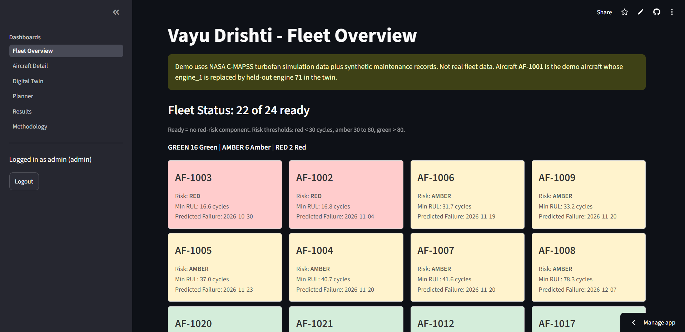<br/><br/>Fleet Overview, view 2<br/>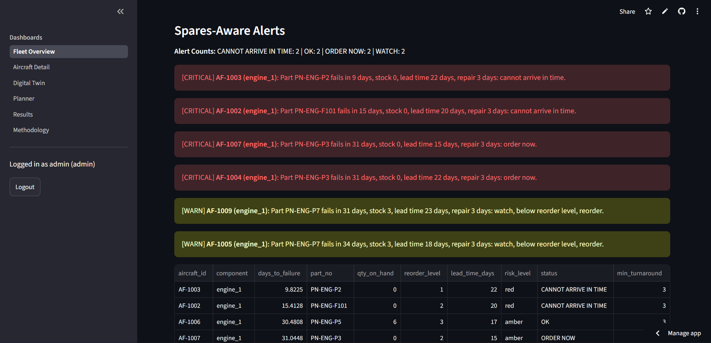<br/><br/>Fleet Overview, view 3<br/>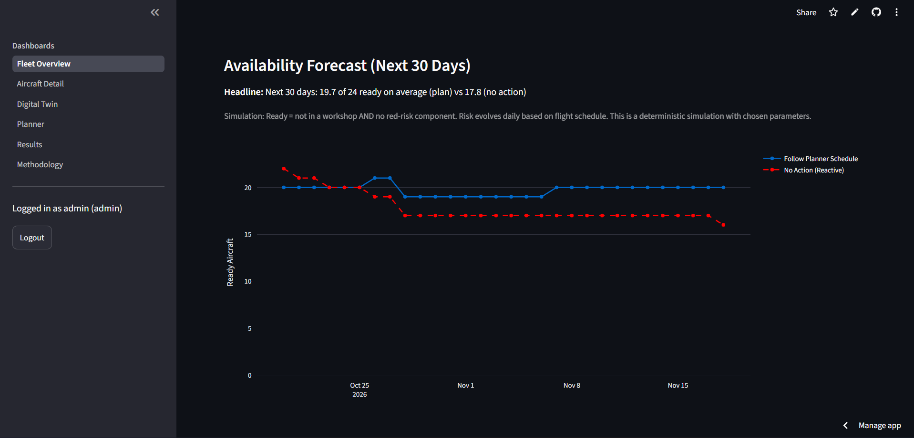 |
| **Aircraft Detail** | Subsystem Telemetry and What-If | 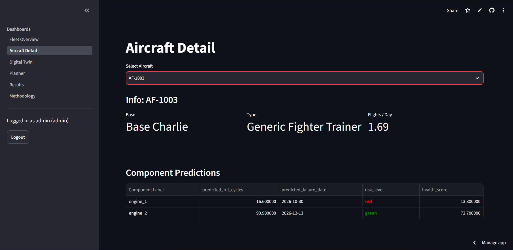 |
| **Digital Twin** | Sensor Replay and Debounced Status | 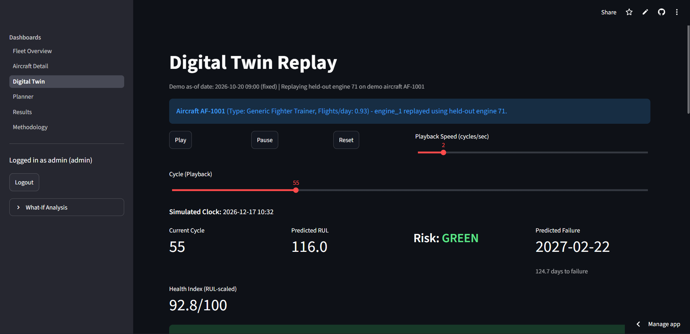 |
| **3D Digital Twin** | Interactive Three.js Airframe View | 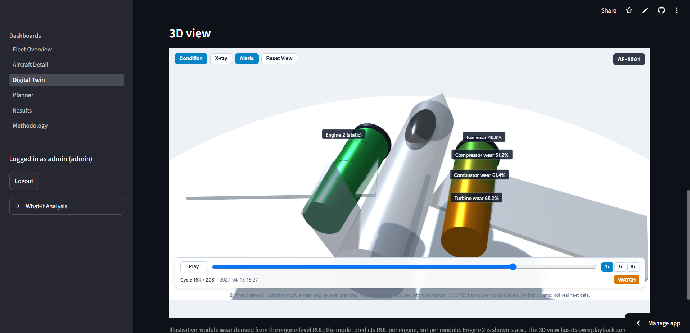 |
| **Planner** | Proactive Maintenance Scheduling | 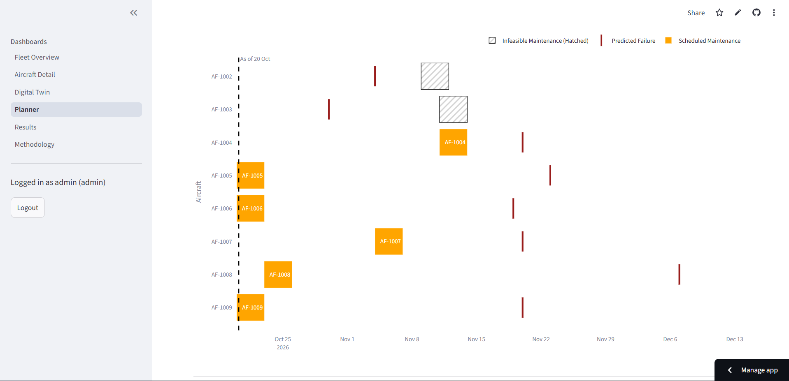 |
| **Results** | Monte Carlo Policy Simulation | 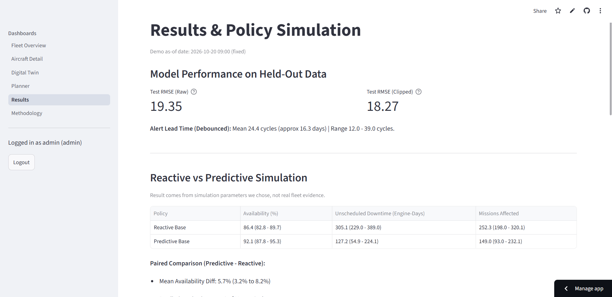 |

<details>
<summary><strong>More screenshots</strong></summary>

| View | Relative File Link |
|---|---|
| Aircraft Detail, view 2 | [docs/images/screenshot-detail2.png](docs/images/screenshot-detail2.png) |
| Aircraft Detail, view 3 | [docs/images/screenshot-detail3.png](docs/images/screenshot-detail3.png) |
| Digital Twin, view 2 | [docs/images/screenshot-twin2.png](docs/images/screenshot-twin2.png) |
| Planner, view 2 | [docs/images/screenshot-planner2.png](docs/images/screenshot-planner2.png) |
| Results, view 2 | [docs/images/screenshot-results2.png](docs/images/screenshot-results2.png) |
| Results, view 3 | [docs/images/screenshot-results3.png](docs/images/screenshot-results3.png) |

</details>

---

## :bar_chart: Results and Validation

All metrics originate directly from reproducible evaluations in `docs/metrics.json` and `docs/sim_results.json`.

### Model Performance (NASA C-MAPSS FD001)

- **Evaluation Environment:** Python 3.13.5, XGBoost 3.4.1
- **Test RMSE (Raw):** `19.35` (evaluated on the final cycle of each test engine against `RUL_FD001.txt`)
- **Test RMSE (Clipped at 125 cycles):** `18.27` (matches operational health thresholding)
- **Validation RMSE (Engine-ID split):** `16.24` (across 20 held-out training engines)
- **Alert Lead Time Runway (Held-Out Engines):**
  - *First Red Alert Crossing (`RUL < 30`):* Mean `30.95` cycles (range: 16 to 57 cycles). At 1.5 flights/day, this provides ~20.6 days advance notice.
  - *Debounced Warning (3 consecutive cycles):* Mean `24.4` cycles (range: 12 to 39 cycles). At 1.5 flights/day, this provides ~16.3 days advance notice.
  - *Reliability:* `0` misses across 20 validation engines; `0` early false alerts (>100 cycles before failure).

### Synthetic Fleet Policy Simulation Results

Evaluated across a 24-aircraft fleet over a 90-day operational horizon (`SIMULATION['days'] = 90`) across 200 Monte Carlo iterations (`SIMULATION['runs'] = 200`), comparing baseline Reactive maintenance against the Vayu Drishti Predictive planner (`ml/sim_config.py`):

| Metric | Reactive Baseline | Predictive Policy | Impact / Delta | Source Key in `docs/sim_results.json` |
|---|---|---|---|---|
| **Fleet Availability** | 86.4% | 92.1% | **+5.7 pp** (95% CI: [3.2%, 8.2%]) | `reactive.availability_mean` -> `predictive.availability_mean` |
| **Predictive Win Rate** | - | - | **100.0%** of runs | `paired_difference.predictive_wins_frac` |
| **Unscheduled Downtime** | 305.1 engine-days | 127.2 engine-days | **-177.9 engine-days** (-58.3%) | `reactive.unscheduled_downtime_days_mean` -> `predictive.unscheduled_downtime_days_mean` |
| **Disrupted Sorties** | 252.3 missions | 149.0 missions | **-103.3 missions** (-41.0%) | `reactive.missions_disrupted_mean` -> `predictive.missions_disrupted_mean` |

*Note: Simulation assumptions and downtime parameters are defined in `ml/sim_config.py`. "Unscheduled Downtime (Engine-Days)" measures cumulative component downtime across all engine failure events; because dual-engine failures on a single airframe can overlap, total unscheduled engine-days can exceed net aircraft downtime days `(1 - availability) * 24 * 90`.*

### Boundary and Stress Sensitivity Analysis

The simulation explicitly evaluates boundary conditions where predictive benefits diminish:
- **Zero Alert Runway Stress Case (`alert_lead_mult = 0.0`):** When prognostic warning runway is eliminated (simulating zero sensor lead time), predictive availability drops to `85.2%` vs `86.4%` reactive baseline, and the predictive planner wins in only `28.0%` of runs (`sensitivity.alert_lead_mult['0.0']`). This proves the platform's gains are driven by advance lead time rather than artificial modeling bias.
- **Double Lead Time Stress (`lead_time_mult = 2.0`):** When supply-chain delays double, predictive availability drops to `87.6%` vs `82.0%` reactive, maintaining a `+5.5 pp` margin with `100.0%` win rate.
- **High False Alarm Stress (`false_alarm_rate = 0.50`):** Even when 50% of alerts are false alarms, predictive availability remains `90.8%` vs `86.4%` reactive (`+4.4 pp` lift).

---

## :wrench: Technical Architecture

### Architectural Data Flow

```text
[ Sensor Stream / Replay ] ---> [ Unified Data Layer ] ---> [ XGBoost RUL Engine ]
                                          |                         |
[ Spares & Workshops CSV ]  --------------+                         v
                                                   [ Streamlit Application ]
                                               (Fleet Cockpit, Twin & Planner)
```

- **Data Layer:** Merges synthetic maintenance logs, parts catalog, spares inventory, workshops, and 60-day flight schedules with engine telemetry.
- **Model Engine:** XGBoost RUL regressor evaluated on NASA C-MAPSS FD001 dataset with rolling means and slope features.
- **Application Interface:** Streamlit UI providing Fleet Overview, Aircraft Detail, Digital Twin with 3D airframe inspection, Proactive Planner, Simulation Results, and Methodology.

### Technical Approach Diagram
<p align="center">
  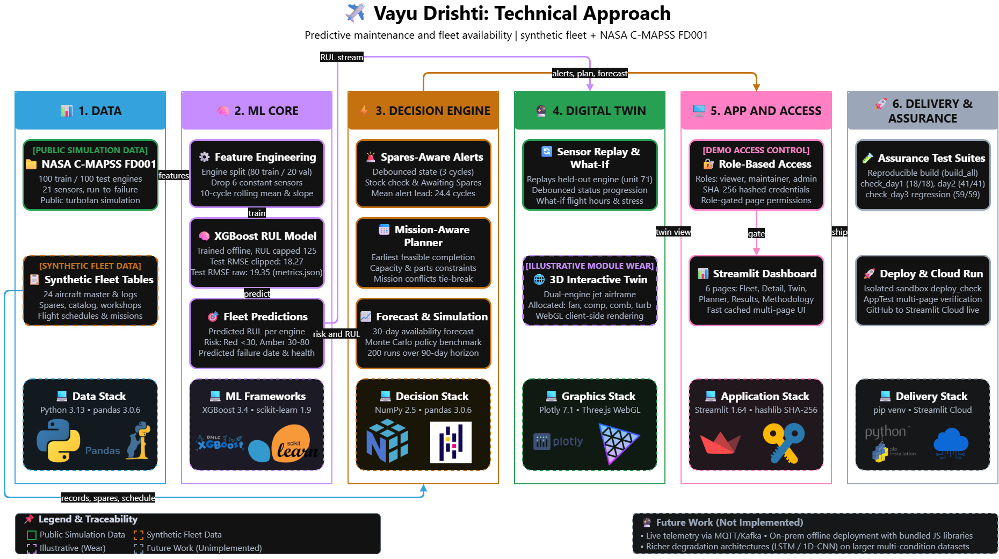
</p>

### Feasibility and Viability Diagram
<p align="center">
  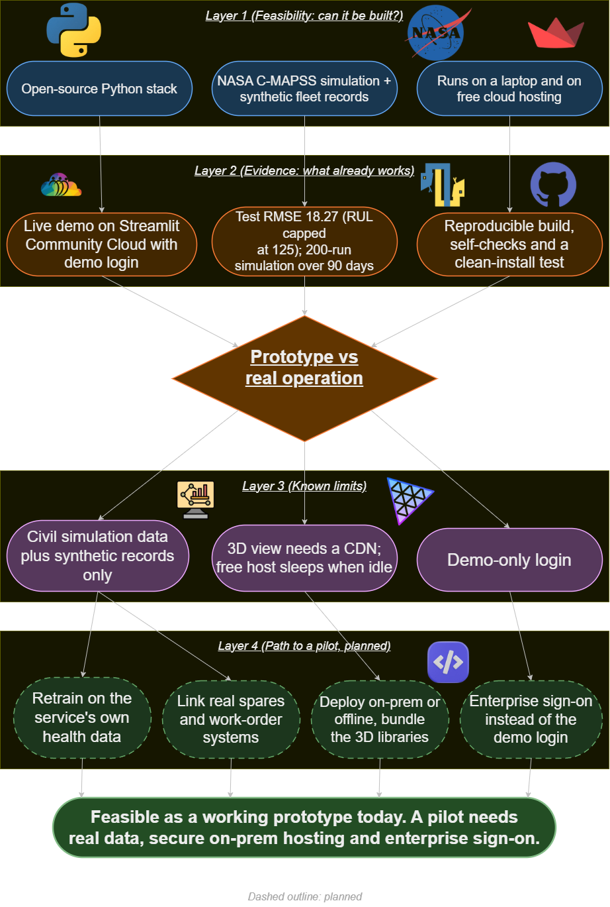
</p>

### Impact and Benefits Diagram
<p align="center">
  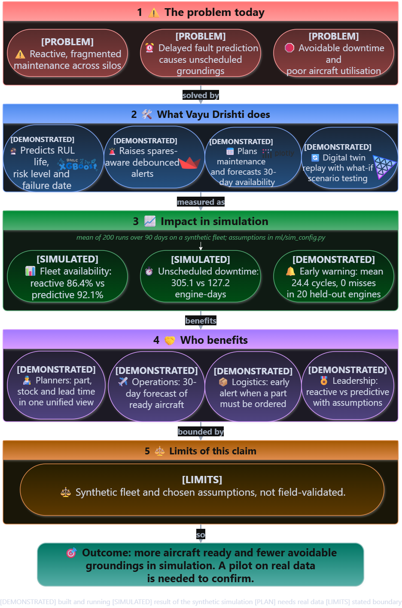
</p>

---

## :lock: Traceability and Honest Framing

### Requirement Traceability

| Problem Statement Requirement | Implementation in Vayu Drishti | Verification in Demo Application |
|---|---|---|
| Fragmented data: health monitoring, technical records, spares, maintenance agencies | Unified data layer joining sensor telemetry, maintenance logs, spares stock, workshops, flight schedule | Aircraft Detail page, spares check |
| Delayed fault prediction | XGBoost RUL regressor with amber/red risk classification and predicted failure dates | Fleet Overview, risk turning amber then red |
| Avoidable aircraft downtime | Spares-aware alert rules and maintenance recommender planning slots before failure | Planner page, spares alerts |
| Sub-optimal utilisation of critical assets | Mission-aware scheduling: maintenance slots avoid assigned missions where possible; 30-day forecast | Planner page, availability forecast chart |
| AI/ML predictive maintenance | RUL regression with reported test RMSE and debounced alert lead time runway | Results page, Methodology page |
| IoT / aircraft health monitoring | Simulated sensor stream replay with debounced temporal health state transitions | Digital Twin page, "Play simulation" button |
| Digital twins | Lightweight per-aircraft health twin: live telemetry, what-if stress analysis, 3D airframe view | Aircraft Detail page, Digital Twin page |
| Integrated maintenance analytics platform | Unified Streamlit application running from `requirements.txt` | Live demo application across all pages |
| **Proof of availability improvement** | Monte Carlo reactive vs predictive policy simulation on synthetic fleet | Results page |

### Honest Framing and Synthetic-Data Disclosure

- **NASA C-MAPSS Dataset:** The underlying predictive model is trained exclusively on public NASA civil turbofan simulation data (FD001), not on real operational military aircraft telemetry.
- **Synthetic Operational Context:** Public datasets contain no records of military flight schedules, depot inventory, parts lead times, or workshop capacities. All operational logistics tables (`flight_schedule`, `maintenance_logs`, `parts_catalog`, `spares_inventory`, `workshops`) are synthetic simulations generated to evaluate the system architecture.
- **No Real-World Fleet Validation:** We do not claim validation on an active military fleet. Availability gains reflect the parameters chosen for policy simulation in `ml/sim_config.py` rather than empirical flight trials.
- **Demo-Only Security:** Authentication and access control are implemented for demonstration and role-based interface evaluation; production defense deployments require enterprise SSO, PKI/smart-cards, and encrypted key management.

---

## :package: Project Details and Documentation

<details>
<summary><strong>Feature list per page</strong></summary>

1. **Fleet Overview (`app/pages/0_Fleet_Overview.py`):**
   - High-level readiness KPIs (Total Aircraft, Available, In Maintenance, Critical Red, Impending Amber).
   - Interactive fleet table with status indicators, engine RULs, and predicted failure dates.
   - Filtering by operational base, risk tier, and aircraft type.
2. **Aircraft Detail (`app/pages/1_Aircraft_Detail.py`):**
   - Per-aircraft subsystem status and historical maintenance records.
   - Sensor z-score trend visualization comparing operational telemetry against baseline distributions.
   - Interactive What-If flight hours slider computing adjusted RUL and accelerated failure dates.
3. **Digital Twin (`app/pages/2_Digital_Twin.py`):**
   - Telemetry replay engine streaming held-out NASA C-MAPSS engine unit 71 on aircraft AF-1001.
   - Debounced temporal status tracking (`OK` -> `WATCH` -> `ORDER NOW` -> `CANNOT ARRIVE IN TIME`).
   - Interactive 3D airframe inspection view with illustrative per-module wear visualization.
4. **Planner (`app/pages/3_Planner.py`):**
   - Proactive 30-day maintenance recommender prioritizing high-risk components.
   - Earliest-feasible-finish slot scheduling respecting workshop turnaround and capacity.
   - Sortie conflict deconfliction flagging overlaps with scheduled missions.
   - Spares inventory lead-time validation.
5. **Results (`app/pages/4_Results.py`):**
   - 200-run Monte Carlo policy simulation comparing reactive vs predictive maintenance.
   - Paired difference distribution and 95% confidence interval for fleet availability lift.
   - Sensitivity analysis sweeps across alert lead multipliers, spare lead times, and false alarms.
6. **Methodology (`app/pages/5_Method.py`):**
   - Transparent documentation of C-MAPSS FD001 dataset processing and feature engineering.
   - Mathematical definitions of cycles-to-dates conversion and debouncing logic.
   - Policy simulation parameters and boundary condition disclosures.

</details>

<details>
<summary><strong>3D Digital Twin implementation details</strong></summary>

- **Telemetry and State Synchronization:** Predicted RUL, risk levels, and spares status originate directly from the trained XGBoost model and the page debounced temporal state machine.
- **Module Wear Allocation:** Per-module wear (fan, compressor, combustor, turbine) is calculated via an illustrative allocation model (`ml/module_wear.py`). NASA C-MAPSS FD001 contains no per-module degradation annotations.
- **Dual-Engine Airframe Geometry:** Dual-engine jet model rendered via Three.js; engine 1 displays dynamic telemetry replayed from held-out validation engine 71, while engine 2 displays static baseline predictions from `data/predictions.csv`.
- **Offline / Air-Gapped Deployment:** The 3D view dynamically loads Three.js and OrbitControls from the jsDelivr CDN; an air-gapped military environment requires bundling these static JavaScript assets locally.

</details>

<details>
<summary><strong>Assumptions and modeling parameters</strong></summary>

- **Cycles to Dates:** One cycle corresponds to one flight sortie. `predicted_failure_date = AS_OF + predicted_rul_cycles / flights_per_day` (where `flights_per_day` ranges from 0.8 to 2.0).
- **RUL Clipping:** True RUL is clipped at 125 cycles during training, reflecting early-life degradation insensitivity.
- **No Feature Scaling:** Features are not scaled because tree-based algorithms like XGBoost are scale-invariant.
- **Engine-ID Split:** Train and validation partitions are split strictly by engine ID (80 train engines, 20 held-out validation engines), preventing row-level data leakage.
- **Synthetic Maintenance Data:** Maintenance logs span 6 to 18 months of operational history. Scheduled maintenance downtime: 1 to 4 days; unscheduled repair: 3 to 14 days. Parts catalog lead times: 5 to 45 days.
- **Demo Aircraft Replay:** Demo aircraft `AF-1001` replays held-out NASA C-MAPSS unit 71 (Generic Fighter Trainer, Base Charlie, 0.93 flights/day).
- **Simulation Horizon:** Policy simulation evaluates 24 aircraft over 90 operational days across 200 runs (`SIMULATION['days'] = 90`, `SIMULATION['runs'] = 200`).
- **Conflict Deconfliction:** Mission conflicts serve as a tie-breaker among equally early workshop slots, and high-priority mission overlaps are flagged.

</details>

<details>
<summary><strong>Run locally (PowerShell)</strong></summary>

```powershell
# 1. Clone repository
git clone https://github.com/shlok-sharma/Vayu-Drishti.git
cd Vayu-Drishti

# 2. Create and activate virtual environment
python -m venv .venv
.venv\Scripts\Activate.ps1

# 3. Install dependencies
pip install -r requirements.txt

# 4. Launch Streamlit application
streamlit run app\main.py
```

</details>

<details>
<summary><strong>Project structure</strong></summary>

```text
Vayu-Drishti/
|-- app/
|   |-- auth.py                  # Demo authentication and role-based access control
|   |-- main.py                  # App entrypoint and login gateway
|   |-- twin3d.py                # Three.js 3D airframe view and payload builder
|   \-- pages/
|       |-- 0_Fleet_Overview.py  # Fleet readiness cockpit
|       |-- 1_Aircraft_Detail.py # Subsystem telemetry and what-if analysis
|       |-- 2_Digital_Twin.py    # Sensor replay and 3D digital twin
|       |-- 3_Planner.py         # Proactive mission-aware maintenance planner
|       |-- 4_Results.py         # Monte Carlo policy simulation results
|       \-- 5_Method.py          # Methodology and disclosure documentation
|-- ml/
|   |-- build_all.py             # Reproducible full pipeline build script
|   |-- check_day1.py            # Day 1 verification suite (22 tests)
|   |-- check_day2.py            # Day 2 verification suite (16 tests)
|   |-- check_day3.py            # Day 3 verification suite (59 tests)
|   |-- config.py                # Project-wide configuration constants
|   |-- debounce.py              # Temporal debounce state machine
|   |-- deploy_check.py          # Clean virtualenv deployment verification
|   |-- evaluate.py              # Model evaluation and alert lead time runner
|   |-- forecast.py              # 30-day availability forecasting logic
|   |-- module_wear.py           # Illustrative per-module wear allocation model
|   |-- planner.py               # Earliest-feasible-finish maintenance planner
|   |-- replay.py                # Telemetry streaming replay engine
|   |-- sim_config.py            # Policy simulation configuration
|   |-- simulate_policies.py     # Monte Carlo policy simulation engine
|   |-- train_baseline.py        # XGBoost training pipeline
|   \-- whatif.py                # Flight hours what-if stress calculator
|-- docs/
|   |-- DEMO_ACCESS.md           # Demo accounts and role permissions
|   |-- DEPLOY.md                # Cloud deployment instructions
|   |-- methodology.md           # Methodology documentation
|   |-- metrics.json             # Evaluated model metrics
|   |-- sim_results.json         # Policy simulation benchmark results
|   \-- images/                  # Flowcharts and application screenshots
|-- data/
|   |-- aircraft_master.csv      # Synthetic 24-aircraft fleet registry
|   |-- flight_schedule.csv      # Synthetic 60-day operational flight missions
|   |-- maintenance_logs.csv     # Historical maintenance logs
|   |-- parts_catalog.csv        # Subsystem parts and lead times
|   |-- planner_recommendations.csv # Precomputed maintenance recommendations
|   |-- predictions.csv          # Fleet RUL predictions and failure dates
|   |-- spares_inventory.csv     # Depot stock levels
|   \-- workshops.csv            # Depot workshop capacities and turnaround times
|-- requirements.txt             # Pinned production runtime dependencies
\-- requirements-dev.txt         # Development and testing dependencies
```

</details>

<details>
<summary><strong>Testing and verification</strong></summary>

The project includes 97 automated self-check tests across three test suites:

```powershell
# Run Day 1 checks (22 tests: model artifacts, predictions, data contracts)
python ml/check_day1.py

# Run Day 2 checks (16 tests: synthetic tables, causality, page rendering)
python ml/check_day2.py

# Run Day 3 checks (59 tests: planner, simulation, debounce, auth RBAC, 3D twin, smoke tests)
python ml/check_day3.py

# Run clean virtualenv deployment verification
python ml/deploy_check.py
```

- **Check Results:** 97 passed, 0 failed, 0 skipped ($LASTEXITCODE = 0).

</details>

<details>
<summary><strong>Reproducibility</strong></summary>

All synthetic datasets, trained model weights, RUL predictions, and simulation results can be regenerated from scratch using the deterministic build script:

```powershell
python ml/build_all.py
```

Repeated runs produce byte-identical SHA-256 hashes across generated files.

</details>

<details>
<summary><strong>Cloud deployment</strong></summary>

Deployment procedures for Streamlit Community Cloud, Hugging Face Spaces, or local container hosts are documented in [docs/DEPLOY.md](docs/DEPLOY.md).

</details>

<details>
<summary><strong>Limitations and future work</strong></summary>

### Limitations
- Public NASA civil engine simulation data, not real military flight records.
- Synthetic operational logistics tables (spares, schedules, workshops).
- Illustrative module wear model based on engine RUL allocation.
- CDN dependency for Three.js and OrbitControls in the 3D twin viewer.
- Demo-only SHA-256 session authentication.

### Future Work
- Integration with live military telemetry buses (e.g. MIL-STD-1553 / MQTT / Kafka).
- Deep learning architectures (LSTM, 1D-CNN, Transformers) trained on complex multi-condition datasets (NASA N-CMAPSS).
- Expansion of physical subsystem models to include airframe structures, avionics, bearings, and battery auxiliary power systems.
- Air-gapped container packaging with local JavaScript and WebGL asset bundling.

</details>

<details>
<summary><strong>Data sources and citations</strong></summary>

- **NASA Prognostics Data Repository:** [NASA Intelligent Systems Division](https://www.nasa.gov/intelligent-systems-division/discovery-and-systems-health/pcoe/pcoe-data-set-repository/) (Turbofan Engine Degradation Simulation Data Set, FD001).
- **Damage Propagation Modeling:** Saxena, A., Goebel, K., Simon, D., and Eklund, N. (2008). *Damage Propagation Modeling for Aircraft Engine Run-to-Failure Simulation*. International Conference on Prognostics and Health Management (PHM08), Denver CO. (Archived in `docs/Damage Propagation Modeling.pdf`).

</details>
